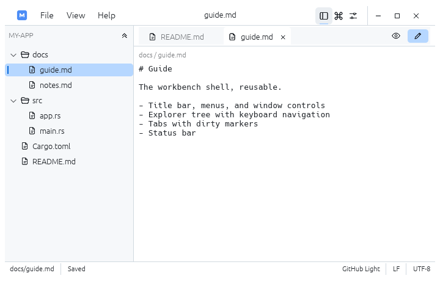

# egui-workbench

[](https://crates.io/crates/egui-workbench)
[](https://docs.rs/egui-workbench)
[](https://github.com/jigonzalez930209/egui-workbench/actions/workflows/ci.yml)
[](#license)

A desktop workbench shell for [egui](https://github.com/emilk/egui): reusable IDE-style
components plus the application runtime that new desktop projects start from.

**[Documentation and live demos →](https://jigonzalez930209.github.io/egui-workbench/)**
Every page runs the real library in your browser through WebAssembly.



- **Components:** nine themes, size tokens, an undecorated window with a custom title
  bar and menus, the document tab strip with the mode switch, the explorer tree, the
  split view, modal prompts, the settings scaffold, the command palette and Quick Open,
  the keyboard menu, the status bar, buttons and form controls, and an icon cache (UI
  glyphs and the VS Code Material file icons).
- **Runtime:** `ThemeState` (follow system, reduced motion), `Documents` (tab order,
  active document, dirty query), `Keymap` (ordered shortcuts that consume handled keys),
  `CloseGuard` (unsaved-changes prompt), and `show_workbench` (the fixed panel order).
- **Charts:** `components::plot::Plot` with lines, areas, steps, scatter, bars, error
  bars, fits, two y axes, log scales, SVG/PNG export, pie/donut, candlesticks, heatmaps,
  radar, gauges, waterfalls, 13 legend hover animations, and a streaming direction arrow.
- **Data viewer:** `components::viewer::FileViewer` for Excel workbooks with sheet tabs
  (XLSX/XLSM/XLS/XLSB/ODS), CSV and TSV, and virtualized plain-text viewing.
- **Icons:** 2,410 Lucide SVGs (ISC, lucide-static 1.77.0) plus the workbench UI glyphs, resolved by name
  through one tinted texture cache.
- **Components:** a shadcn-style layer with builders, shared variants, and stateful
  controls: `Button`, `IconButton`, `IconPreview`, `TextField`, `TextArea`, `Switch`, `Checkbox`,
  `Select`, `Stepper`, `SegmentedControl`, `Badge`, `Banner`, `Card`, `Separator`,
  `StatusBar`, `MenuItem`, `TabStrip`, `CommandPalette`, `Tree`, and dialogs. The
  original function API stays available.

The crate holds the shell plus reusable content components: charts and a data viewer.
It ships no editor or document renderer. Components take translated strings and return
events; the application owns the state and one `Command` enum.

- **Specification:** [`WORKBENCH.md`](WORKBENCH.md) gives every size, color, order, and
  behavior.
- **Component guide:** [`docs/COMPONENTS.md`](docs/COMPONENTS.md) and
  [`examples/catalog`](examples/catalog).
- **Icon guide:** [`docs/ICONS.md`](docs/ICONS.md).
- **Complete example:** [`examples/showcase`](examples/showcase) uses the runtime.
- **Starter application:** [`templates/app`](templates/app), generated with
  `cargo xtask new`.

```bash
cargo run --example showcase -- /path/to/folder
cargo run --example catalog                      # live component catalog
cargo test
UPDATE_SNAPSHOTS=1 cargo test --test snapshots   # after an intended visual change
cargo clippy --all-targets -- -D warnings
cargo xtask template-check                       # generated starter still compiles
```

## Documentation

The complete guide lives in [`docs-site`](docs-site) (VitePress):

```bash
cd docs-site
npm install
npm run dev          # local preview
npm run build        # static site in .vitepress/dist
npm run build:demo   # rebuild the wasm component catalog
npm run check-examples
```

The guide embeds a live WebAssembly build of `examples/catalog` at `/guide/live-demo`
(`web/` is the wasm entry point).

What comes next — CI on every desktop platform, a declarative host, and bindings for
Python, JavaScript, and any language — is in [`ROADMAP.md`](ROADMAP.md).

Rust API docs are generated by rustdoc and checked with warnings denied:

```bash
cargo doc --workspace --no-deps --open
RUSTDOCFLAGS="-D warnings" cargo doc --workspace --no-deps
```

The tests drive every component through `egui_kittest`. They click widgets found by
their accessible name, press keys, drag, and compare PNG references in
`tests/snapshots/`. WORKBENCH.md §15 lists what each file covers.

## Use it with AI agents

[`skills/egui-workbench`](skills/egui-workbench/SKILL.md) is an
[agent skill](https://agentskills.io) that teaches coding agents to build apps with this
crate: setup, the `WorkbenchApp`/`Command` model, a compiling minimal app, the design
rules, and the whole guide as Markdown.

```text
/plugin install egui-workbench --marketplace jigonzalez930209/egui-workbench   # Claude Code
npx skills add jigonzalez930209/egui-workbench                                 # Codex, Cursor, Gemini, Copilot…
```

Claude.ai: upload `egui-workbench-skill.zip` from the latest release. More options:
[Use with AI agents](https://jigonzalez930209.github.io/egui-workbench/guide/ai-agents.html).

## Start a new application

```bash
git clone https://github.com/jigonzalez930209/egui-workbench
cd egui-workbench
cargo xtask new ../my-app --title "My App"
cd ../my-app
cargo run
```

`xtask` copies [`templates/app`](templates/app) and replaces the package name, window
title, and the path to this crate. The result compiles as-is and is deliberately
domain-neutral: title bar and menus, tabs, a navigator, a placeholder content screen,
status bar, command palette, settings, theme switching, shortcuts, atomic settings
persistence, and unsaved-changes prompts for both the window and dirty tabs. The
product seams are `src/model.rs` (`TabData`), `src/content.rs` (the screen), and
`App::save_tab` (persistence). Read [`docs/NEW_PROJECT.md`](docs/NEW_PROJECT.md).

## Use it as a dependency

```toml
[dependencies]
egui-workbench = "0.2"
# or the latest main:
# egui-workbench = { git = "https://github.com/jigonzalez930209/egui-workbench" }
```

The crate builds on egui and eframe **0.37** from crates.io and re-exports both
(`egui_workbench::egui`, `egui_workbench::eframe`); use the re-exports, or the same 0.37
versions, so your app links one copy. Disable the ~5 MB Material file icons with
`default-features = false` if your app has no files.

```rust
use egui_workbench::{egui, eframe, metrics::*, theme, Icons, ThemeId};

fn main() -> eframe::Result {
    eframe::run_native("App", egui_workbench::native_options("App"),
        Box::new(|cc| { theme::apply_theme(&cc.egui_ctx, ThemeId::GithubLight, false); Ok(Box::new(App::default())) }))
}
```

Then implement `egui_workbench::app::WorkbenchApp` for the fixed panel order, or call
the panels directly. For product screens, use the component builders:

```rust
use egui_workbench::components::prelude::*;

TextField::new(&mut state.name).label("Name").show(ui);
if Switch::new(&mut state.wrap).label("Word wrap").show(ui) {
    state.dirty = true;
}
if Button::new("Save").show(ui).clicked() {
    state.save();
}
```

See WORKBENCH.md §3 and §13, [`docs/COMPONENTS.md`](docs/COMPONENTS.md), and
[`docs/ARCHITECTURE.md`](docs/ARCHITECTURE.md).

## Source layout

```text
src/
├── foundation/     sizes, theme tokens, UI, Lucide and Material icon caches
├── chrome/         window, title bar, tab strip, status bar, split view
├── widgets/        the function API: buttons, controls, dialogs, palette, settings, tree
├── components/     builder API, variants, tones, charts, file viewer, composite blocks
└── app/            optional runtime: theme state, documents, keymap, close guard, shell
templates/app/      starter application copied by `cargo xtask new`
docs-site/          complete VitePress guide, component reference, charts, and recipes
web/                wasm entry point for the live in-browser component catalog
xtask/              repository tasks: new, check, snapshots, fmt
examples/showcase/  complete application using the runtime
```

Files stay under 500 lines and each layer only depends on the ones before it
(`foundation` → `widgets`/`chrome` → `components` → `app` → application).

## License

MIT OR Apache-2.0. The Material icons in `assets/material-icons` are MIT
(`assets/material-icons/LICENSE`). The Lucide icons in `assets/lucide-icons` are ISC
(`assets/lucide-icons/LICENSE`). Workbook parsing uses `calamine` (MIT).
